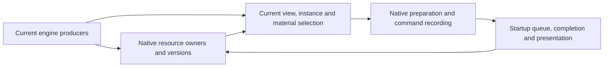

# Direct connection design — D-0156 restart

Primary framing, 2026-10-09, cycle730. Status: design restarted; selected resource
membership implemented733; [material preparation734–772](DIRECT-MATERIAL-PREPARATION.md)
owns fade, current material/programme leases, typed instance/MTD values and
current animated numeric writes packed against actual shader-used ranges and
bounded native material classification and current texture declaration/lease preparation. Material-to-command
closure remains open. This replaces the sequence
chosen by Native112's fault. The objective and acceptance rules stay in the
[mandate](../../.project/NATIVE-D3D12-RESET-MANDATE.md).

## Source basis and limits

[ER716](ER-ENGINE-D3D12-DEEP-STUDY-716.md) follows actual
current model selection, dynamic stream creation/update, material constants,
native bindings, upload completion and withdrawal/presentation.
[Primary receipt730](../../evidence/I-0066/ER-METHOD-PRIMARY-730.json) records
22 checked source/RTTI/ASM files and input/report hashes. This accepts the
nominal method, not every branch of113 functions or an ER runtime guarantee.

The decisive ER associations are:

- `1401E92F0` writes current CPU channels into declared geometry, then records
  an update through `1419E4ED0/141E8D570`; `140B75270` selects that owner's buffer
  in the ordinary current Flver stream-binding path `141AAAE90`.
- `141ABFFF0/141ACF120` copy current material bytes into current upload storage;
  `141E9BE20` builds a CBV from that allocation's address. Current preparation
  precedes `141ACAF20/141E8E0D0` indexed emission.
- `141EAC840/141EAC850/141EAB300` attach an actual queue/fence token to upload
  blocks and test completion before recycling. A CPU ready flag is not a fence.
- `140B74E50/141A973A0` withdraw and defer references; `141AF4580` uses a CPU
  countdown. Its universal relation to last GPU use is unproved. Native Present
  exists, but the worker's concrete callback registration remains unresolved.

DS3 source basis: [selected view700](../../evidence/I-0066/SELECTED-VIEW-CPU-700.md),
pose/stream [RCA703](../../evidence/I-0066/RCA-MODEL-MATRICES-703.md) and
[RCA712](../../evidence/I-0066/RCA-MODEL-STREAMS-712.md), and preserved current
owners in `native/frame/game_bootstrap.cpp`. ER offsets and CPU delay policy
are not DS3 contracts.

## One ownership domain

These are responsibilities inside the integrated backend, not a publication
transport. Current engine storage requests create native resources on the
startup device. Selection acquires the same owners' current versions. Preparation
resolves actual resources, values and state into existing native encoders.
Recording retains everything it uses until actual completion. Withdrawal
prevents future selection without destroying outstanding uses.

The entry is the owned stage CPU update's current view preparation, using that
view's world/culler and current camera. Loaded-model enumeration cannot replace
selection. Preserve genuine CPU visibility, masks, fade/variant and placement
semantics. Unsupported families remain explicit initial defects, never invented
legacy readiness or a rendering fallback.

## Contracts to implement together

| Responsibility | Required direct contract | Existing component / disposition |
|---|---|---|
| Static geometry | CPU load establishes an owner/incarnation, exact IB/VB slices and native resource. Selected meshes retain that owner. | Reuse `NativeModelStorage`, `CopyModelGeometry` and native buffer upload; extend supported layouts from DS3 evidence. |
| Dynamic geometry and pose | Current CPU writer publishes a successful version under its owner. Selection resolves the actual instance's stream/pose association and keeps that version. | Reuse physical stream and pose algorithms/snapshots. Their current construction does not qualify updates or selected use. |
| Material/shader/texture | Current mesh material association chooses real programmes, authored values, dynamic values and current native texture versions. Every used shader field has a producer or explicit unavailable result. | Reuse model material/layout leases, shader bank, texture ingress, `ds3prod` producers and their written masks. Host numbering/defaults are not production semantics. |
| Draw preparation | Current selection plus complete bindings resolves native IA, root tables, PSO, targets and pass state; it does not upload a detached second copy of the selected model by default. | Reuse `gbuffer_encoder.h` and qualified host pass algorithms. Adapt their direct owner/resource inputs; the limited `SceneWork` fixture envelope is not the game-wide ABI. |
| Submission and lifetime | Copies, barriers, constants and draws have one explicit order. A recording owns resources/descriptors/uploads until its actual submission token completes. | Reuse startup `DeviceQueues`, `FrameRecorder`, existing fenced leases and native transitions. Start with the existing serialized queue/completion model; no ER frame-delay assumption. |
| Output and shutdown | Same native frame ownership reaches the engine window/swapchain. Resize drains affected work and recreates current-size targets; failure keeps unfinished resources alive. | Reuse startup `SceneRenderer`/`FramePresenter`, explicit completion and quarantine behavior. Presentation is not a second host. |

Native identity includes owner incarnation/version, not a borrowed engine address
alone. A reused engine address cannot resolve a retired resource. Taking a version
must not race withdrawal. Immutable updates are the initial design choice, matching
existing snapshots; recorded commands keep their chosen version even if a later
CPU update publishes another. Completion, not elapsed CPU frames, permits reuse.

Keep the existing serialized startup device/queue. Resource admission and frame
recording follow one documented lock order; do not hold producer locks while
waiting for callbacks that need those locks. Initial synchronous completion is
acceptable. Adding asynchronous rings is a later performance decision, not a
prerequisite or an opportunity to invent another transport.

## DS3 closure still needed

The current collector now retains actual mesh material/layout leases and binds
the same geometry/current physical allocations under the [bounded resource contract733](DIRECT-MODEL-INPUTS.md).
Programme recipes and generic register3 numeric blocks are now prepared under
current owner leases; bounded material classification761 consumes native policy
and the current CPU special flag. Texture preparation763 owns SPX/FLVER identity,
actual register/alias metadata and selected named native generations. Bounded
shader-register coverage765 matches those same leases. Current view/scene/instance constants768 pack only marked words against actual USED declarations; complete bindings and sampler policy remain open. Complete
texture/default coverage, pass eligibility, other constants and FaceGen selection remain open. Its limited
LOD0/R16/single-stream admission is not complete selected-zone coverage.
Current material/layout owners retain authored CPU metadata, but their native
pipeline readiness is explicitly false. Native112 does not qualify these joins.

Recover one coherent selected-model responsibility chain, rather than another
fault site: `D079C0 → 59040 → 575C0/57A20`, selected mesh/material/instance
preparation and associated pose/stream/texture owners, then the used constant
producers and native pass state. Already retained `5C0E0` mixes CPU preparation
with old renderer allocation; forwarding it wholesale would preserve a dependency.
Its decompiler prototypes are not callable ABIs. Check actual ASM and callers.

The grouped read-only [source export731](../../evidence/I-0066/artifacts/direct-model-contract-731/provenance.json)
already distinguishes three responsibilities: `575C0` mixes current pass-specific
CPU calculations with old renderer services; `BF330` calculates a bounded sorting
value from current view/position inputs; `BF4C0` allocates and appends records in
the old context's queue. They are not a material-resource resolver. Preserve needed
selection/order semantics while the native backend owns its recording storage;
do not reconstruct that legacy queue as a production requirement. The complete
selected mesh/material/pose/stream bundle and its call ABI remain the next source
question. No crash site selected this acquisition.

For each participating owner, cover creation, successful CPU update, selected
consumption, invalidation/replacement and destruction. Map which responsibilities
are pure engine CPU semantics and which belong to the native backend. Close this
map before choosing concrete replacement entries. Reuse existing recovered sources
first; acquire only missing edges that change the implementation contract.

Then implement this whole resource-to-selected-command slice with the existing
device/encoders/presentation, validate actual current-resource identity and retained
versions, and run one announced independent-zone protocol. Initial omitted visual
families are recorded against the mandate; unrelated crash fixes do not become
new development stages. No code or live qualification is claimed by this design.
